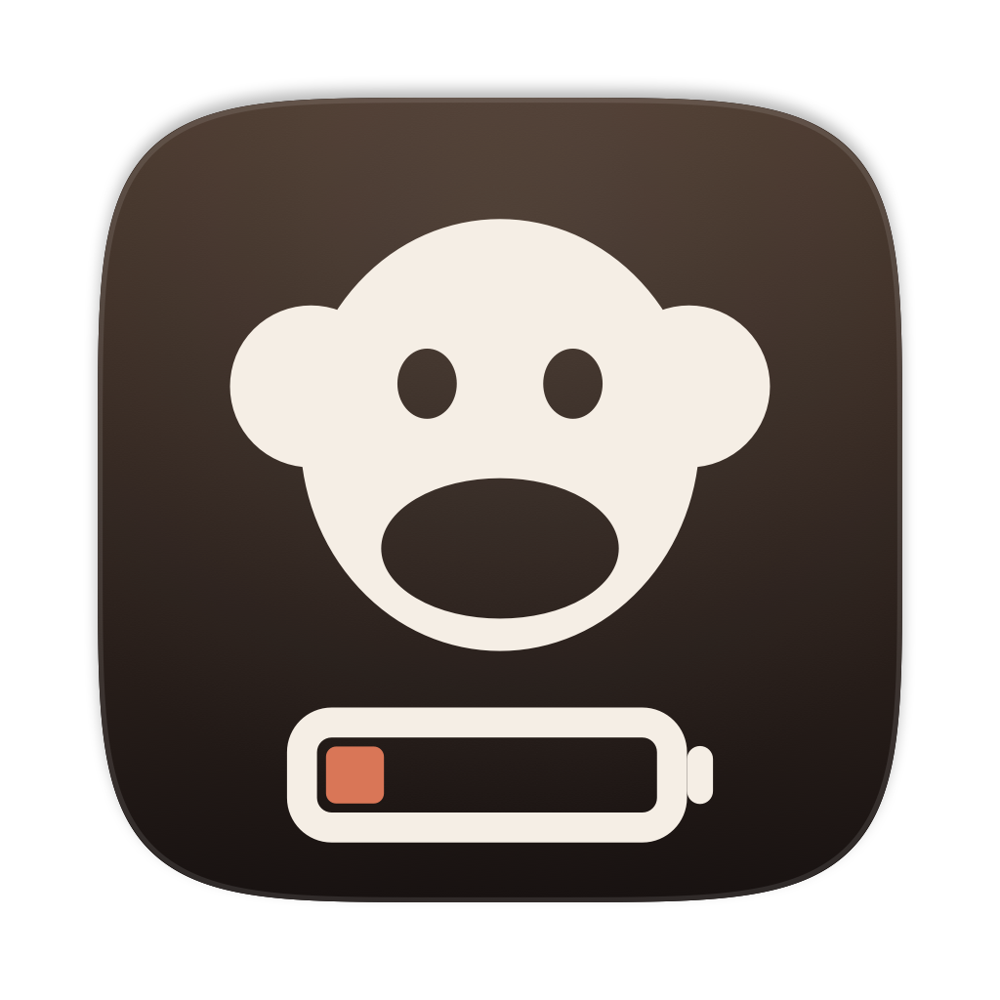
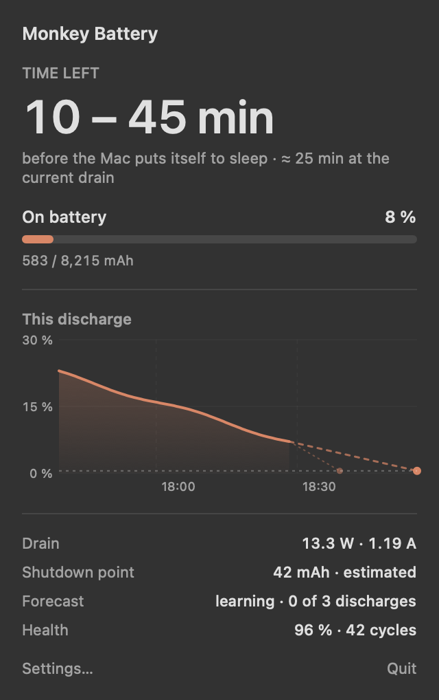
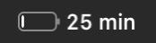
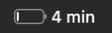
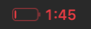
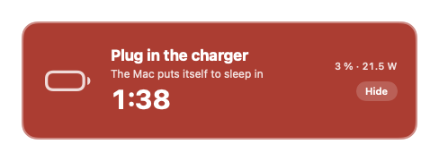

<div align="center">



# Monkey Battery

**How long your Mac has left on battery, shown in the menu bar, with an alarm you can't miss.**

[](https://github.com/my-monkeys/monkey-battery/actions/workflows/ci.yml)
[](LICENSE)
[](#install)
[](Package.swift)



</div>

You are deep in something, the battery icon says 2 %, and you don't notice. A minute later the
screen goes black. The work you hadn't saved is gone, and you never got a warning you could
actually see.

This app makes that warning hard to miss. Below 10 %, it puts the time left next to the battery
icon: the time you can count on, even if you open something heavy next. The figure counts
down to the moment the Mac puts itself to sleep, not to an optimistic 0 %. In the last two minutes, a red panel appears above every window, every Space
and every full-screen app, and an alarm sounds until the charger is plugged in.

<table>
<tr>
<td align="center"><br><sub><b>Below 10 %</b><br>the time left, nothing else</sub></td>
<td align="center"><br><sub><b>Five minutes</b><br>one notification, one chime</sub></td>
<td align="center"><br><sub><b>Two minutes</b><br>red, and the panel below</sub></td>
</tr>
</table>

<div align="center">

</div>

## Install

```bash
brew install --cask my-monkeys/tap/monkey-battery
```

Or take the `.dmg` from [Releases](https://github.com/my-monkeys/monkey-battery/releases) and
drag the app to `/Applications`. It is signed and notarized by Apple, so it opens on the first
double-click.

**macOS 14 Sonoma or later.** Apple silicon and Intel. A few megabytes, no Electron.

## Put it next to the battery icon

macOS adds new menu bar icons to the left of all the others, and it doesn't let an app choose
where its icon goes. For the first minute after launch the icon stays visible: **hold ⌘ and
drag it** next to the battery icon. macOS remembers that spot.

After that the icon only shows up when the battery is low. To bring it back at any other time,
open the app again from Spotlight or Launchpad.

## Why not just trust the system estimate?

macOS withholds its own estimate for several minutes after you unplug ("no estimate"), and its
0 % is not when the Mac actually stops. So this app reads the battery gauge directly: the
charge in mAh and the current. It smooths the drain over a few minutes, so a short spike
doesn't move the figure and a heavy compile does. It also projects the charge forward between
gauge updates, so the countdown never freezes. Every figure is rounded down.

The Mac may also put itself to sleep **before** the gauge reaches zero, and Apple doesn't say
how far before. Until it knows, the app keeps a small 0.5 % reserve. Every discharge narrows it
down: if your Mac keeps running below that point, the app lowers it to the lowest charge it has
seen your Mac running at. And the first time the battery actually runs out, it records where
your Mac stopped.

## It grades its own forecasts

A forecast is only as good as the assumption behind it: that you keep using the Mac the way
you are now. You rarely do. At 10 % on an idle Mac, the drain says three hours; start a build
and it is fifty minutes.

No curve can tell what you will open next, but the app can measure how much your drain
tends to change. After every discharge, it goes back over what it announced and checks it
against what actually happened. From those errors it learns a range, which it shows in the
popover: "10 – 45 min", with the figure at the current drain underneath. The menu bar and
the alerts use the low end of that range, so you are warned in time even when the drain
climbs. The range starts out wide, and narrows to your own habits after three discharges.

## What it doesn't do

- No analytics, no crash reporting, nothing sent anywhere. The only network request is the
  update check on GitHub.
- No helper, no privileges, no background daemon. The battery gauge is readable by any app;
  this one just reads it more carefully than most.

## Try the alarm without draining your battery

```bash
"/Applications/Monkey Battery.app/Contents/MacOS/MonkeyBattery" --simulate 3
```

This plays back a discharge starting at 3 %. Right-click the icon to plug in the simulated
charger and watch everything stand down.

---

**[Releasing →](docs/RELEASING.md)** · `swift build`, `swift test`, then `./scripts/build-dmg.sh`
to build from source.

A [My-Monkey](https://my-monkey.fr) project, sibling of
[Monkey Claude Usage](https://github.com/my-monkeys/monkey-claude-usage).
[BSD-2-Clause](LICENSE).
